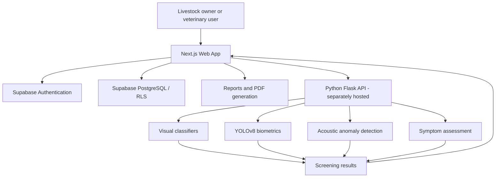

<div align="center">

# 🐾 JeevRaksha

### Multimodal AI-Powered Veterinary Intelligence

**Intelligent health insights for every herd.**

A veterinary decision-support platform combining visual screening, acoustic analysis, animal biometrics, symptom assessment, and organized herd-health records.

<br />

[](https://jeevraksha-veterinary-intelligence.vercel.app/)
[](https://github.com/KethineniVenkataAvinash/JeevRakshaVeterinaryIntelligence)

<br />


</div>

---

## Overview

**JeevRaksha** is a multimodal veterinary intelligence platform designed to make early animal-health screening and record management more accessible to livestock owners and veterinary professionals. Rather than relying on a single observation, its architecture brings together **animal images, respiratory audio, physical measurements, and symptom descriptions** to support preliminary health assessment.

The application offers a responsive web dashboard, guided diagnostic workflows, a veterinary reference guide, a scan history, and report generation. Authentication and persistent records use **Supabase**, while trained machine-learning models are served by a **separate Python inference backend**.

> **Deployment status:** The Next.js website is deployed on Vercel. Live machine-learning inference requires the separate Flask API to be running and accessible through `NEXT_PUBLIC_API_URL`. A successful frontend deployment does not, by itself, deploy the AI models.

### Quick links

| Resource | Link |
| --- | --- |
| **Live web application** | [Open JeevRaksha](https://jeevraksha-veterinary-intelligence.vercel.app/) |
| **Source repository** | [JeevRakshaVeterinaryIntelligence](https://github.com/KethineniVenkataAvinash/JeevRakshaVeterinaryIntelligence) |
| **Database setup** | [`SUPABASE_SETUP.md`](SUPABASE_SETUP.md) |
| **Database migration** | [`20261108_initial_schema.sql`](supabase/migrations/20261108_initial_schema.sql) |
| **Dataset reference** | [Kaggle dataset](https://www.kaggle.com/datasets/9a28eb7397e7cf7dd7ac05fc4490fd82e3ab07c398bcf9333911e9e55b36090d) |
| **Model-weight reference** | [External model files](https://drive.google.com/drive/folders/1OP03SAv2DTILw8vMcha4QO_NaEQGljtJ?usp=sharing) |

## Contents

- [Platform capabilities](#platform-capabilities)
- [Multimodal AI pipeline](#multimodal-ai-pipeline)
- [Architecture](#architecture)
- [Technology stack](#technology-stack)
- [Repository structure](#repository-structure)
- [Getting started](#getting-started)
- [Supabase configuration](#supabase-configuration)
- [Connecting the Python AI backend](#connecting-the-python-ai-backend)
- [Deployment](#deployment)
- [Model research and evaluation](#model-research-and-evaluation)
- [Application gallery](#application-gallery)
- [Project report](#project-report)
- [Security, limitations, and responsible use](#security-limitations-and-responsible-use)
- [Development roadmap](#development-roadmap)
- [Author](#author)

---

## Platform capabilities

### 🩺 Guided diagnostic workspace

The diagnostic interface groups complementary screening tasks into a single workflow:

| Workflow | Input | Purpose |
| --- | --- | --- |
| **Symptom assistant** | Written or spoken symptom description | Structured symptom assessment through the configured inference service |
| **Full AI scan** | Animal measurements, images, and audio | Combine visual, biometric, and respiratory observations |
| **Skin analysis** | Animal photograph | Screen visible skin and lesion patterns |
| **Respiratory audio** | Recorded or uploaded sound | Flag acoustic patterns that may warrant veterinary attention |
| **Image-based biometrics** | Animal photograph and relevant parameters | Support weight and body-condition assessment |
| **Manual weight calculator** | Body measurements | Provide a measurement-based weight estimate without requiring the ML API |

AI-driven results depend on backend availability, model quality, and the suitability of the supplied input. Outputs are **screening assistance, not confirmed clinical diagnoses**.

### 📊 Herd-health dashboard and records

- Personalized dashboard with scan totals, summary indicators, and recent diagnostic activity.
- **Seasonal Pathogen Watch** and **Regional Threat Radar** reference panels that direct users to relevant conditions in the clinical guide.
- User-associated scan history stored in Supabase with row-level security controls.
- Reports and trends built from the records available to the signed-in account.

**Data note:** The seasonal and regional reference panels should not be interpreted as verified, real-time epidemiological surveillance feeds unless such a data source is separately connected.

### 📚 Clinical guide and reporting

- Searchable livestock disease reference pages with symptoms, transmission, prevention, and care considerations.
- Printable diagnostic summaries and report-generation functionality, including browser-side PDF tools.
- Past scan records that can be revisited for ongoing monitoring and follow-up.
- Biosecurity education, hygiene considerations, and guidance to seek qualified veterinary care.

### 🔐 Accounts, settings, and accessibility

- Supabase email-based authentication, signup, password recovery, and protected application routes.
- Profile types available during signup: **Farmer, Veterinarian, and Admin**.
- Responsive interface designed for mobile and desktop usage.
- Speech-driven assistant and navigation features, subject to browser microphone and speech-recognition support.
- Multilingual interface support covering English and selected Indian languages, including Hindi, Telugu, Tamil, Kannada, and Malayalam.
- Account settings and device-stored notification preferences.

> The role selector is a profile feature; production-grade role-based authorization must be enforced server-side. Notification preferences shown in settings do not necessarily indicate that SMS or push delivery has been configured.

---

## Multimodal AI pipeline

The companion Python backend is designed to route input to specialized machine-learning components. These are distinct from the Next.js frontend hosted in this repository.

### 1. Species recognition and visual screening

**EfficientNetV2 + two-stage image classification**

- Species classification across six livestock categories, as described in the model documentation.
- First-stage visual screening followed by a second-stage disease classifier for more focused image analysis.
- Research emphasis on dermatological conditions such as **Lumpy Skin Disease** and **Foot-and-Mouth Disease**.
- Checkpoints include `best_species_model_finetuned.pth`, `stage1_best_finetuned.pth`, and `stage2_best_finetuned.pth`.

### 2. Animal segmentation and biometrics

**Ultralytics YOLOv8 segmentation**

- Extracts animal contours and image geometry for downstream estimation.
- Supports image-assisted weight and body-condition-score (BCS) workflows.
- Uses a `yolov8n-seg.pt` model checkpoint within the separate backend.

Weight and BCS inferred from photos are approximations; calibration, camera perspective, breed, and other factors can affect reliability.

### 3. Respiratory acoustic screening

**librosa + PyTorch 1D CNN autoencoder**

- Audio preprocessing and feature extraction, including spectral representations.
- Reconstruction-based anomaly screening against learned reference sound patterns.
- Reconstruction error compared with a saved threshold to flag unusual recordings.
- Companion assets include `audio_autoencoder.pth` and `audio_threshold.npy`.

An acoustic anomaly cannot, on its own, establish the presence or type of respiratory disease.

### 4. Natural-language symptom assessment

**Symptom understanding and triage workflow**

- Accepts a user's description of observable signs.
- Supports voice-assisted symptom entry where the browser permits it.
- Connects to the configured `/analyze_symptoms` endpoint for model-backed responses.
- The project research notes describe a **BERT-based** direction for contextual symptom interpretation; deployment of that specific model must be confirmed in the running backend.

### AI capabilities at a glance

| Area | Principal approach | Primary output |
| --- | --- | --- |
| Vision | EfficientNetV2 and staged classifiers | Species and visual screening results |
| Biometrics | YOLOv8 segmentation and geometric estimation | Estimated weight / body condition |
| Audio | Feature extraction and CNN autoencoder | Acoustic anomaly indicator |
| Symptom assessment | NLP-driven triage pipeline | Structured symptom insights |

---

## Architecture



**Operational separation**

- **Frontend:** Next.js application, hosted on Vercel.
- **Identity and storage:** Supabase authentication and PostgreSQL, with row-level security.
- **Inference service:** Flask/Python process with its own dependencies, trained weights, compute resources, and HTTPS endpoint.
- **Connectivity:** The frontend calls the inference service over HTTP(S); the backend must explicitly allow the frontend's origin where CORS applies.

The frontend invokes `POST /analyze` for diagnostic input and `POST /analyze_symptoms` for symptom assessment. The detailed request/response contract is defined by the running Python service, which is not part of this frontend repository.

## Technology stack

| Layer | Technologies |
| --- | --- |
| Web framework | Next.js 16, React 19, TypeScript |
| Styling and icons | Tailwind CSS 4, Lucide React |
| Authentication | Supabase Auth, `@supabase/ssr` |
| Persistence | Supabase PostgreSQL, Row Level Security |
| Charts and reports | Recharts, jsPDF, jsPDF AutoTable |
| AI service | Python, Flask, PyTorch, Ultralytics, librosa *(separate backend)* |
| Deployment | Vercel *(frontend)*; independent hosting required for inference |

## Repository structure

The GitHub repository contains the **Next.js web application**, not the full local Python training workspace.

```text
JeevRakshaVeterinaryIntelligence/
├── app/
│   ├── about/                 # Platform and technology information
│   ├── auth/                  # Authentication callback page
│   ├── diagnose/              # Multimodal diagnosis interface
│   ├── guide/                 # Veterinary clinical guide
│   ├── history/               # Scan history
│   ├── login/                 # Login and account registration
│   ├── reports/               # Reports and record analysis
│   ├── settings/              # Account and preferences
│   ├── update-password/       # Password management
│   ├── globals.css            # Global styles
│   ├── layout.tsx             # Application layout and voice interface
│   └── page.tsx               # Main dashboard
├── public/                    # Static assets
├── scripts/                   # Build utilities
├── supabase/
│   └── migrations/            # PostgreSQL setup and policies
├── utils/
│   └── supabase/              # Supabase client utilities
├── .gitignore
├── next.config.ts
├── package.json
├── package-lock.json
├── postcss.config.mjs
├── proxy.ts                    # Authentication-aware request protection
├── tailwind.config.ts
├── tsconfig.json
├── SUPABASE_SETUP.md
└── README.md
```

> Model checkpoints (`.pth`, `.pt`), training scripts, `app.py`, and Python `requirements.txt` belong to the **separate AI backend workspace**. They are not included in this frontend GitHub repository.

---

## Getting started

### Prerequisites

- Node.js compatible with Next.js 16 (Node.js **20.9 or newer** recommended).
- npm, included with Node.js.
- A Supabase project for authentication and scan history.
- Optional: access to the separately running Flask backend for AI inference.

### 1. Clone the repository

```bash
git clone https://github.com/KethineniVenkataAvinash/JeevRakshaVeterinaryIntelligence.git
cd JeevRakshaVeterinaryIntelligence
```

### 2. Install dependencies

```bash
npm ci
```

### 3. Configure environment variables

Create **`.env.local`** in the repository root:

```dotenv
NEXT_PUBLIC_SUPABASE_URL=https://YOUR_PROJECT.supabase.co
NEXT_PUBLIC_SUPABASE_ANON_KEY=YOUR_SUPABASE_PUBLISHABLE_OR_ANON_KEY
NEXT_PUBLIC_API_URL=http://localhost:5000
```

- Set the first two variables to your Supabase project values.
- Set `NEXT_PUBLIC_API_URL` to the URL of the Python service when using AI-backed features.
- In a cloud deployment, the backend URL must be reachable over HTTPS.
- **Never commit `.env.local`**, private credentials, service-role keys, or model-provider secrets.
- Variables beginning with `NEXT_PUBLIC_` are exposed to client-side code and must **not contain secrets**.

### 4. Start the development server

```bash
npm run dev
```

Open **http://localhost:3000** in your browser.

### Useful commands

| Command | Action |
| --- | --- |
| `npm run dev` | Start the local development server |
| `npm run build` | Build the application |
| `npm run start` | Serve the production build |
| `npm run lint` | Run ESLint |
| `npm run typecheck` | Run TypeScript checks |

---

## Supabase configuration

The frontend uses Supabase for accounts and user-associated records.

1. Create or open your project in [Supabase](https://supabase.com/).
2. Copy the **Project URL** and **publishable/anon key** into `.env.local`.
3. Open **SQL Editor** in the Supabase dashboard.
4. Execute [`supabase/migrations/20261108_initial_schema.sql`](supabase/migrations/20261108_initial_schema.sql) if the schema has not yet been applied.
5. Enable email-based sign-up in **Authentication → Providers**.
6. Configure **Authentication → URL Configuration** for your local and production application URLs.

Suggested production values:

```text
Site URL:
https://jeevraksha-veterinary-intelligence.vercel.app

Allowed redirect URL:
https://jeevraksha-veterinary-intelligence.vercel.app/auth/callback
```

For local work, also allow your development origin and its expected callback route.

The migration defines the `scan_history` storage structure, relevant policies, and avatar-related storage. For further details, see [`SUPABASE_SETUP.md`](SUPABASE_SETUP.md).

## Connecting the Python AI backend

The backend is maintained outside this web repository. To run the complete local system, use your existing Python project directory containing `app.py`, `requirements.txt`, and model assets.

**Windows PowerShell:**

```powershell
cd "path\to\your\python-backend"
py -m venv .venv
.\.venv\Scripts\Activate.ps1
pip install -r requirements.txt
python app.py
```

**macOS / Linux:**

```bash
cd /path/to/your/python-backend
python3 -m venv .venv
source .venv/bin/activate
pip install -r requirements.txt
python app.py
```

Confirm that the backend is listening at the address configured in `NEXT_PUBLIC_API_URL` (commonly `http://localhost:5000` for local Flask development). Model weights must be available at the paths expected by `app.py`.

### Model assets

The research workspace references the following assets:

```text
best_species_model_finetuned.pth
stage1_best_finetuned.pth
stage2_best_finetuned.pth
yolov8n-seg.pt
audio_autoencoder.pth
audio_threshold.npy
```

[External model-weight folder](https://drive.google.com/drive/folders/1OP03SAv2DTILw8vMcha4QO_NaEQGljtJ?usp=sharing) · [Dataset reference](https://www.kaggle.com/datasets/9a28eb7397e7cf7dd7ac05fc4490fd82e3ab07c398bcf9333911e9e55b36090d)

The availability, licensing, and version of these external assets should be checked before relying on them. Do not commit large trained weights, local virtual environments, or sensitive data to the frontend repository.

---

## Deployment

### Frontend — Vercel

The public web app is hosted at:

**[https://jeevraksha-veterinary-intelligence.vercel.app](https://jeevraksha-veterinary-intelligence.vercel.app/)**

To create a new deployment:

1. Import this repository at [vercel.com/new](https://vercel.com/new).
2. Set **Framework Preset** to `Next.js`.
3. Set **Root Directory** to `./` because `package.json` is in the repository root.
4. Leave the default build, install, and output configuration unless your deployment requires an override.
5. Add the required environment variables in Vercel Project Settings.
6. Deploy the `main` branch, then confirm the login page, auth flows, dashboard, and reports.

Required/optional variables:

| Variable | Purpose |
| --- | --- |
| `NEXT_PUBLIC_SUPABASE_URL` | Supabase project endpoint |
| `NEXT_PUBLIC_SUPABASE_ANON_KEY` | Supabase browser-safe key |
| `NEXT_PUBLIC_API_URL` | HTTPS address of separately hosted Python inference API |

After changing Vercel environment variables, **redeploy** the application to include the new values.

### Backend — independent hosting

The Python inference server is **not automatically deployed by Vercel** when deploying this Next.js project. Deploy it independently to infrastructure capable of running the needed ML dependencies and loading model checkpoints. Before enabling AI features publicly, validate:

- Resource requirements (CPU/GPU memory, model loading time, and request timeouts).
- HTTPS connectivity to the model API.
- CORS policy allowing the JeevRaksha domain.
- Input limits, authentication, rate limiting, and request logging that avoids sensitive animal-owner data.
- Correct responses from `/analyze` and `/analyze_symptoms`.

---

## Model research and evaluation

The project research materials include confusion matrices for species classification and two-stage visual classification.

<details>
<summary><strong>Species classification — confusion matrix</strong></summary>

<br />


</details>

<details>
<summary><strong>Stage 1 visual classifier — confusion matrix</strong></summary>

<br />


</details>

<details>
<summary><strong>Stage 2 visual classifier — confusion matrix</strong></summary>

<br />


</details>

**Evaluation note:** These figures are research artifacts, not a guarantee of clinical performance. No precision, recall, F1 score, sensitivity, or real-world validation figure is claimed here without a reproducible evaluation protocol and corresponding numerical results.

---

## Application gallery

The following screenshots are supplied with the project documentation.

<div align="center">

**Dashboard and diagnostic interface**


<br />
<br />


<br />
<br />


</div>

<details>
<summary><strong>View more application screenshots</strong></summary>

<div align="center">

<br />


<br />
<br />


<br />
<br />


</div>

</details>

## Project report

**[View the project report (PDF)](https://github.com/user-attachments/files/25621532/Report.pdf)**

<div align="center">
  
</div>

---

## Security, limitations, and responsible use

- **Clinical scope:** JeevRaksha is a screening and decision-support tool. It does not replace a veterinary examination, laboratory test, professional diagnosis, or prescribed treatment.
- **Urgent cases:** For breathing difficulty, severe injury, suspected contagious disease, or rapidly worsening signs, contact a qualified veterinarian promptly and follow local animal-health guidance.
- **AI uncertainty:** Outputs depend on training data, input quality, model calibration, and backend availability. False positives and false negatives are possible.
- **Credentials:** Never commit Supabase service-role credentials, passwords, `.env.local`, or private model access tokens. Only browser-safe configuration should use the `NEXT_PUBLIC_` prefix.
- **Access control:** Database row-level security is essential; client-side profile labels alone must not grant privileged access.
- **Deployment scope:** Frontend availability does not prove the AI service is online. Configure and test the external API independently.
- **Local notifications:** Saved notification preferences are not a substitute for an operational SMS, email, or push-delivery service.
- **Model governance:** Validate model behavior for relevant breeds, environments, languages, and devices before broader field use.

## Development roadmap

- [x] Responsive Next.js interface and authenticated application routes.
- [x] Supabase-backed scan history and database schema.
- [x] Diagnostic input workflows, reference guide, and report pages.
- [x] Public frontend deployment on Vercel.
- [ ] Independently deploy and validate the Python AI inference service for public use.
- [ ] Add reproducible model benchmarking with clearly documented datasets and metrics.
- [ ] Expand integration testing for authentication, diagnosis, and report generation.
- [ ] Connect verified regional animal-health alerts and veterinary service directories.
- [ ] Implement and test production notification delivery.
- [ ] Strengthen monitoring, accessibility checks, and privacy controls.

---

## Author

<div align="center">

### Kethineni Venkata Avinash

**Developer — JeevRaksha Veterinary Intelligence**

[](https://github.com/KethineniVenkataAvinash)

**[Explore the source](https://github.com/KethineniVenkataAvinash/JeevRakshaVeterinaryIntelligence)** · **[Launch JeevRaksha](https://jeevraksha-veterinary-intelligence.vercel.app/)**

<sub>Built to make livestock-health information and early screening more accessible.</sub>

</div>

---

> **Licensing:** No license is declared in this repository. Review permissions with the author before redistributing or reusing the project or its research assets.
